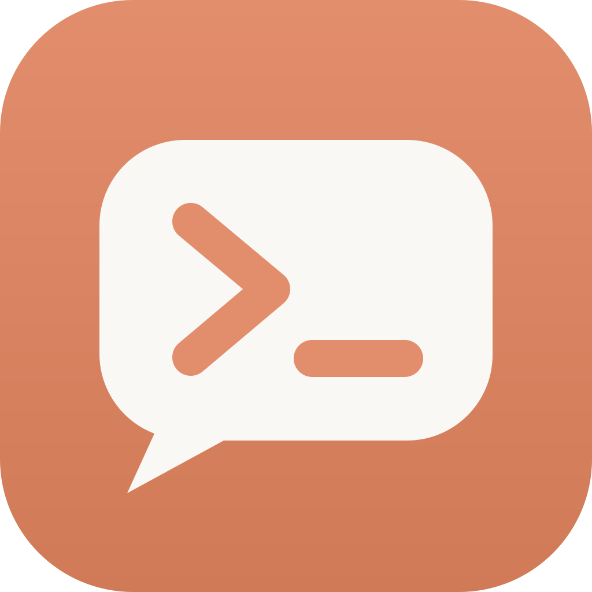
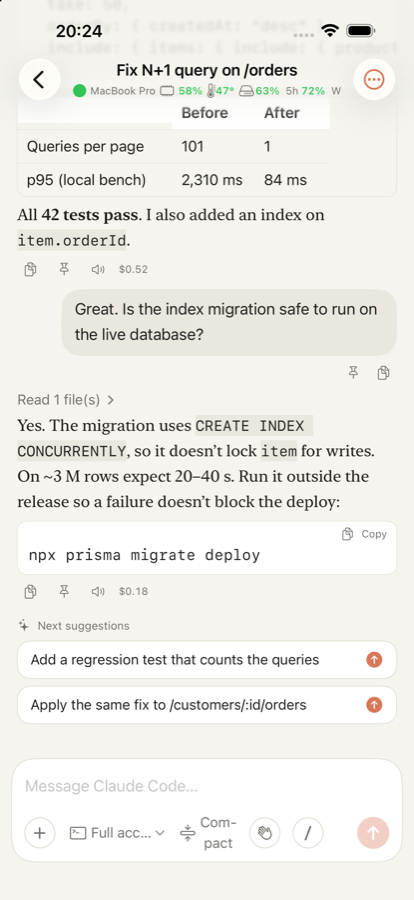
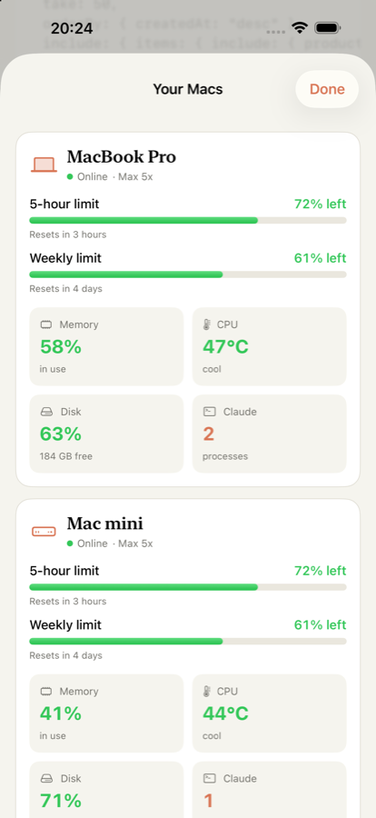

<p align="center">
  <a href="https://remotecc.dev"></a>
</p>
<p align="center"><a href="README.md">English</a> · <a href="README.zh-CN.md">简体中文</a> · <a href="README.es.md">Español</a> · <a href="README.ja.md">日本語</a> · <a href="README.fr.md">Français</a></p>
<h1 align="center">RemoteCC</h1>
<p align="center"><b>El control remoto para tus agentes de programación.</b><br>
Ejecuta Claude Code y Codex en tu propio ordenador y contrólalos desde tu teléfono o cualquier navegador.<br>
Cifrado de extremo a extremo · sin cuentas · nada guardado en la nube · código abierto.</p>

<p align="center">
  <a href="https://apps.apple.com/app/id6797019430"></a>
</p>

<p align="center">
  <a href="LICENSE"></a>
  <a href="https://github.com/Remotecc-dev/remotecc/stargazers"></a>
  <a href="https://remotecc.dev"></a>
  
</p>

<p align="center">
  <a href="https://remotecc.dev">Abrir la aplicación web</a> ·
  <a href="https://remotecc.dev/install.md">Guía de instalación</a> ·
  <a href="https://remotecc.dev/how-it-works">Cómo funciona</a> ·
  <a href="https://remotecc.dev/security">Seguridad</a>
</p>

<p align="center"><b>Compatible con</b><br>
  <a href="https://remotecc.dev/claude-code"></a>
  <a href="https://remotecc.dev/codex"></a>
  
</p>

<p align="center">
  
  &nbsp;&nbsp;
  
</p>

## Qué obtienes

- **Todas las sesiones de tus agentes, en directo** — inicia, sigue y responde desde tu teléfono, tablet u otro portátil: salida en streaming, llamadas a herramientas, preguntas, archivos e imágenes en una vista de chat limpia.
- **Controla tus límites** — uso restante del plan (ventanas de 5 horas y semanales, con horarios de reinicio), tokens y coste por sesión.
- **Vigila tu equipo** — RAM en uso, temperatura de la CPU y espacio libre en disco del ordenador que ejecuta el trabajo.
- **Trabaja en paralelo** — sesiones hijas y ramas, preguntas rápidas al margen con **btw**, y respuestas con un gesto de cabeza o levantando los dedos.
- **Privado por diseño** — cifrado de extremo a extremo (X25519 + AES-256-GCM), relay ciego, versiones firmadas y secretos que nunca salen de tu ordenador.
- **Corre donde programas** — macOS, Linux y Windows (WSL2). Instalación con un solo comando.

## Aplicación web o app para iPhone

El bridge, la aplicación web y el relay son **gratuitos y de código abierto, con todas las funciones** — sin funciones bloqueadas. La app de iPhone es un cliente nativo opcional para el mismo bridge.

| | Aplicación web (gratuita, código abierto) | RemoteCC para iPhone |
|---|---|---|
| Dónde | [remotecc.dev](https://remotecc.dev), o servida por tu propio bridge en `http://127.0.0.1:7791` | [App Store](https://apps.apple.com/app/id6797019430) |
| Sesiones, nuevos turnos, archivos, artefactos, secretos | Sí | Sí |
| Uso del plan, estado del equipo | Sí | Sí, más una vista general de varios ordenadores |
| Funciona en | Cualquier navegador moderno — escritorio, Android, iPhone, iPad | iPhone, iPad |
| Extras nativos | — | Notificaciones, descubrimiento por Wi-Fi, Face ID, widgets |
| Precio | Gratis | Descarga gratuita, suscripción opcional |

## Úsalo desde Claude Code (plugin)

Deja que Claude instale y configure RemoteCC por ti:

```
/plugin install remotecc --marketplace Remotecc-dev/remotecc
```

Luego pídele: *"Configura RemoteCC para que pueda usarlo desde mi teléfono."* (En versiones anteriores de Claude Code: `/plugin marketplace add Remotecc-dev/remotecc`, y después `/plugin install remotecc@remotecc`.)

## Inicio rápido

1. En el ordenador donde ejecutas Claude Code, abre una terminal y ejecuta:

   ```bash
   curl -fsSL https://remotecc.dev/install.sh | bash
   ```

2. Abre **[remotecc.dev](https://remotecc.dev)** en un navegador. En el mismo ordenador se empareja automáticamente; desde otro dispositivo ejecuta `remotecc pair` y escanea el código QR con la cámara del teléfono o la app de iPhone.
3. Elige un proyecto y envía un mensaje. Claude Code (o Codex) se ejecuta en tu ordenador y tú lo ves en directo.

### Dos formas de abrir la aplicación web

| | Dónde | Ideal para |
|---|---|---|
| **Local** | `http://127.0.0.1:7791`, servida por el bridge en tu ordenador (`remotecc web`) | Usar Claude Code en el mismo ordenador sin depender de remotecc.dev. Es el mismo código que el sitio web, extraído de la versión firmada que instaló el bridge (archivos `web-*`), así que se actualiza junto con el bridge y nunca carga la app desde internet |
| **Alojada** | [remotecc.dev](https://remotecc.dev) | Teléfonos, tablets y otros ordenadores (los navegadores requieren HTTPS para conectarse a tu equipo desde otro dispositivo) |

Ambas se emparejan de la misma manera y hablan con el mismo bridge. Puedes desactivar la versión local poniendo `"local_web": 0` en la configuración del bridge.

Windows: RemoteCC se ejecuta dentro de WSL2 — consulta [remotecc.dev/windows](https://remotecc.dev/windows).

## Cómo funciona

```
 browser / iPhone  <==  end-to-end encrypted  ==>  bridge  ->  claude (Claude Code CLI)
        |                                            |
        +----------->  relay.remotecc.dev  <---------+      (blind: forwards ciphertext, keeps no messages)
               (or direct over your LAN / Tailscale, still encrypted)
```

- El **bridge** (Python, `bridge/`) se ejecuta en tu ordenador, gestiona los datos locales (`~/.remotecc`) y lanza `claude`.
- La **aplicación web** (`web/`) consiste en archivos estáticos; solo guarda una clave de emparejamiento en tu navegador.
- El **relay** (`relay/`, un Cloudflare Worker + Durable Object) conecta ambos extremos cuando no están en la misma red. Nunca tiene acceso a las claves ni almacena mensajes.

## Modelo de seguridad

- Emparejamiento: acuerdo de claves X25519; cada trama se cifra con AES-256-GCM (claves derivadas con HKDF-SHA256); el enlace de emparejamiento caduca en minutos y cada emparejamiento se confirma con un código de 4 dígitos en el ordenador.
- El relay solo ve el tamaño y la cadencia del texto cifrado. Las notificaciones push llevan un texto fijo y un identificador de sesión aleatorio.
- Las versiones están firmadas. El bridge solo instala actualizaciones firmadas con la clave de lanzamiento de RemoteCC `ClDHkat2E/DjMTt0HZuMFSdOItSIwnQA7WBf/ssB7YQ=` (Ed25519). Puedes verificar cualquier descarga tú mismo con `./verify-release.sh`.
- Los secretos que añades se cifran en el navegador para tu ordenador y se guardan en su llavero del sistema.
- Informa de vulnerabilidades a **support@remotecc.dev**; consulta `SECURITY.md`.

## Estructura del repositorio

| Ruta | Descripción |
|---|---|
| `bridge/` | El bridge, el CLI (`remotecc`) y las piezas del instalador (Python) |
| `web/` | La aplicación web (`web/public`), su Cloudflare Worker (`web/src`), `install.sh`, `deploy.sh` y pruebas |
| `relay/` | El relay ciego (Cloudflare Worker + Durable Object) |
| `plugins/remotecc/` | Plugin de Claude Code (skill + `/remotecc-pair`), registrado en `.claude-plugin/marketplace.json` |
| `docs/` | `PROTOCOL.md` (formato de red del que depende la app de iOS) e imágenes del README |

## Autoalojamiento

Todo funciona con Cloudflare Workers estándar, sin base de datos.

- Web: `cd web && npx wrangler deploy` (worker `remotecc-web`, activos estáticos desde `web/public`). Cambia la ruta en `web/wrangler.toml` por tu dominio.
- Relay: `cd relay && npx wrangler deploy` (worker `remotecc-relay`, ruta `relay.remotecc.dev`). Las notificaciones push necesitan los secretos de wrangler `APNS_KEY` y `APNS_KEY_ID` (y `APNS_TEAM` en `wrangler.toml`); omítelos para ejecutarlo sin notificaciones push.
- El host del relay se toma de los datos de emparejamiento, de modo que un bridge apuntando a tu propio relay también funciona con la aplicación web alojada.
- Firma: genera tu propia clave de lanzamiento Ed25519, publica su clave pública en el instalador y firma las versiones con `web/deploy.sh`.

## Pruebas

```bash
cd web && node --test test/*.test.mjs        # web crypto/format, plus interop with the Python bridge
# interop needs Python with `cryptography`:  PY=/path/to/python node --test test/*.test.mjs
node --check relay/src/relay.js
```

## Contribuir

Los issues y pull requests son bienvenidos. Mantén la compatibilidad hacia atrás del protocolo de red (`docs/PROTOCOL.md`): la app de iPhone publicada depende de él (enlaces `clo2://`, información de clave `clo2-lan`, rutas del relay). Ejecuta las pruebas antes de enviar un PR.

## Licencia

Apache-2.0 © 2026 RemoteCC. Contacto: support@remotecc.dev.

No afiliado con Anthropic. Claude y Claude Code son marcas registradas de Anthropic.
