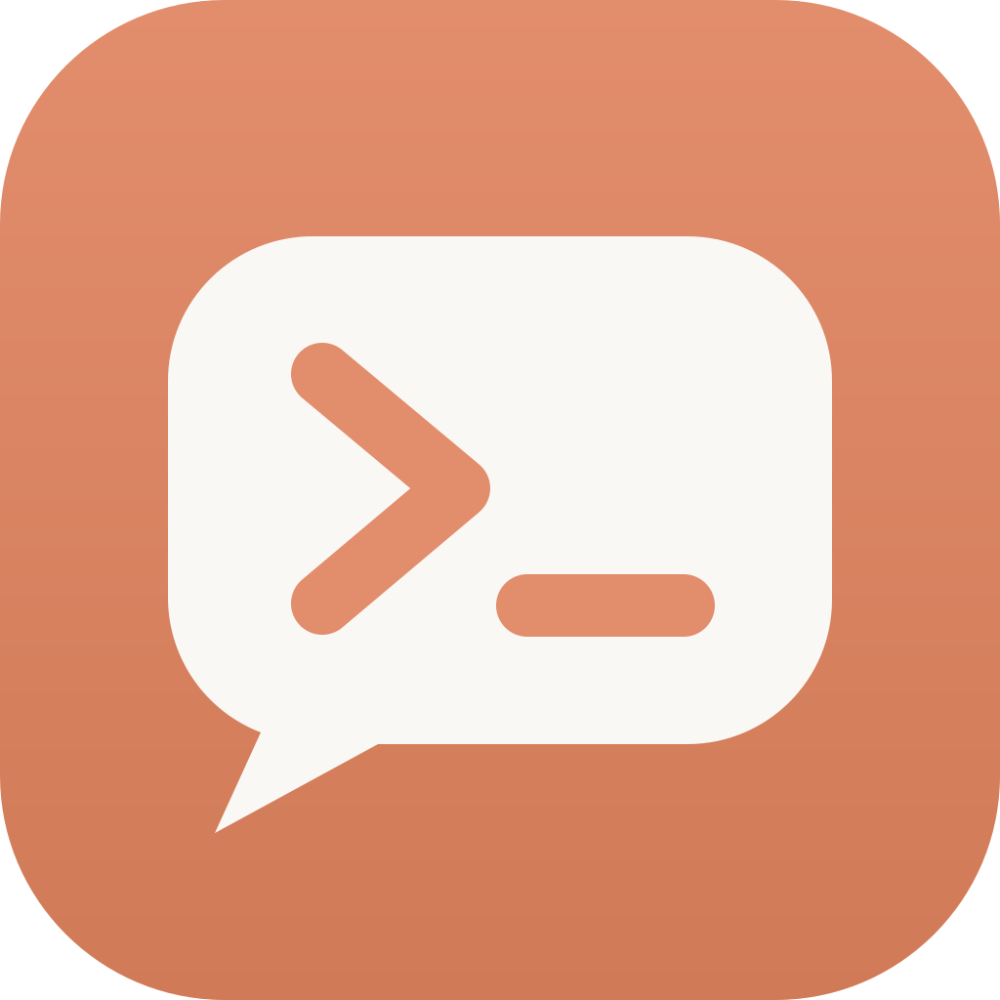
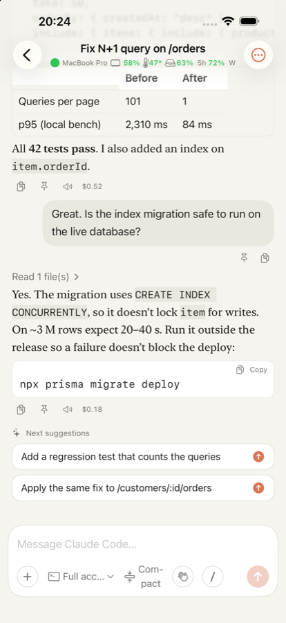
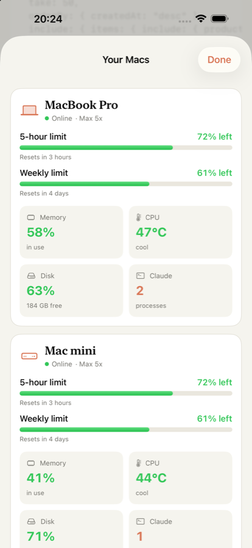

<p align="center">
  <a href="https://remotecc.dev"></a>
</p>
<p align="center"><a href="README.md">English</a> · <a href="README.zh-CN.md">简体中文</a> · <a href="README.es.md">Español</a> · <a href="README.ja.md">日本語</a> · <a href="README.fr.md">Français</a></p>
<h1 align="center">RemoteCC</h1>
<p align="center"><b>La télécommande pour vos agents de code.</b><br>
Exécutez Claude Code et Codex sur votre propre ordinateur — pilotez-les depuis votre téléphone ou n'importe quel navigateur.<br>
Chiffré de bout en bout · sans compte · rien stocké dans le cloud · open source.</p>

<p align="center">
  <a href="https://apps.apple.com/app/id6797019430"></a>
</p>

<p align="center">
  <a href="LICENSE"></a>
  <a href="https://github.com/Remotecc-dev/remotecc/stargazers"></a>
  <a href="https://remotecc.dev"></a>
  
</p>

<p align="center">
  <a href="https://remotecc.dev">Ouvrir l'application web</a> ·
  <a href="https://remotecc.dev/install.md">Guide d'installation</a> ·
  <a href="https://remotecc.dev/how-it-works">Fonctionnement</a> ·
  <a href="https://remotecc.dev/security">Sécurité</a>
</p>

<p align="center"><b>Compatible avec</b><br>
  <a href="https://remotecc.dev/claude-code"></a>
  <a href="https://remotecc.dev/codex"></a>
  
</p>

<p align="center">
  
  &nbsp;&nbsp;
  
</p>

## Ce que vous obtenez

- **Toutes les sessions d'agents sur votre ordinateur, en direct** — démarrez, suivez et répondez depuis votre téléphone, tablette ou un autre ordinateur portable : sortie en streaming, appels d'outils, questions, fichiers et images dans une interface de chat épurée.
- **Suivez vos quotas** — consommation restante du forfait (fenêtres de 5 heures et hebdomadaires, heures de réinitialisation), tokens et coût par session.
- **Surveillez votre machine** — RAM utilisée, température du CPU et espace disque libre de l'ordinateur qui exécute les tâches.
- **Travaillez en parallèle** — sessions enfants et branches, questions rapides en aparté avec **btw**, réponses d'un hochement de tête ou en levant les doigts.
- **Confidentiel par conception** — chiffrement de bout en bout (X25519 + AES-256-GCM), relais aveugle, versions signées ; vos secrets restent sur votre ordinateur.
- **Tourne là où vous codez** — macOS, Linux et Windows (WSL2). Une seule commande pour l'installer.

## Application web ou app iPhone

Le bridge, l'application web et le relais sont **gratuits et open source, avec toutes les fonctionnalités** — rien n'est bridé. L'app iPhone est un client natif optionnel pour le même bridge.

| | Application web (gratuite, open source) | RemoteCC pour iPhone |
|---|---|---|
| Accès | [remotecc.dev](https://remotecc.dev), ou servi par votre propre bridge sur `http://127.0.0.1:7791` | [App Store](https://apps.apple.com/app/id6797019430) |
| Sessions, nouveaux tours, fichiers, artefacts, secrets | Oui | Oui |
| Quotas du forfait, état de la machine | Oui | Oui, avec une vue d'ensemble multi-ordinateurs |
| Fonctionne sur | Tout navigateur moderne — ordinateur, Android, iPhone, iPad | iPhone, iPad |
| Bonus natifs | — | Notifications, découverte Wi-Fi, Face ID, widgets |
| Prix | Gratuit | Téléchargement gratuit, abonnement optionnel |

## L'utiliser depuis Claude Code (plugin)

Laissez Claude installer et configurer RemoteCC pour vous :

```
/plugin install remotecc --marketplace Remotecc-dev/remotecc
```

Demandez ensuite : *« Configure RemoteCC pour que je puisse l'utiliser depuis mon téléphone. »* (Anciennes versions de Claude Code : `/plugin marketplace add Remotecc-dev/remotecc`, puis `/plugin install remotecc@remotecc`.)

## Démarrage rapide

1. Sur l'ordinateur qui fait tourner Claude Code, ouvrez un terminal et exécutez :

   ```bash
   curl -fsSL https://remotecc.dev/install.sh | bash
   ```

2. Ouvrez **[remotecc.dev](https://remotecc.dev)** dans un navigateur. Sur le même ordinateur, l'appairage se fait tout seul ; depuis un autre appareil, lancez `remotecc pair` et scannez le QR code avec l'appareil photo du téléphone ou l'app iPhone.
3. Choisissez un projet, envoyez un message. Claude Code (ou Codex) tourne sur votre ordinateur ; vous le voyez en direct.

### Deux façons d'ouvrir l'application web

| | Adresse | Idéal pour |
|---|---|---|
| **Local** | `http://127.0.0.1:7791`, servi par le bridge sur votre ordinateur (`remotecc web`) | Utiliser Claude Code sur le même ordinateur sans dépendre de remotecc.dev. C'est exactement le même code que le site, issu de la version signée installée par le bridge (fichiers `web-*`) : il se met à jour avec le bridge et ne charge jamais l'application depuis Internet |
| **Hébergé** | [remotecc.dev](https://remotecc.dev) | Téléphones, tablettes et autres ordinateurs (les navigateurs exigent HTTPS pour joindre votre ordinateur depuis un autre appareil) |

Les deux s'appairent de la même façon et communiquent avec le même bridge. Désactivez la version locale avec `"local_web": 0` dans la configuration du bridge.

Windows : RemoteCC tourne dans WSL2 — voir [remotecc.dev/windows](https://remotecc.dev/windows).

## Fonctionnement

```
 browser / iPhone  <==  end-to-end encrypted  ==>  bridge  ->  claude (Claude Code CLI)
        |                                            |
        +----------->  relay.remotecc.dev  <---------+      (blind: forwards ciphertext, keeps no messages)
               (or direct over your LAN / Tailscale, still encrypted)
```

- Le **bridge** (Python, `bridge/`) tourne sur votre ordinateur, gère les données locales (`~/.remotecc`) et lance `claude`.
- L'**application web** (`web/`) est constituée de fichiers statiques ; elle ne conserve qu'une clé d'appairage dans votre navigateur.
- Le **relais** (`relay/`, un Cloudflare Worker + Durable Object) connecte les deux lorsqu'ils ne sont pas sur le même réseau. Il ne détient jamais de clé et ne stocke aucun message.

## Modèle de sécurité

- Appairage : échange de clés X25519 ; chaque trame est chiffrée en AES-256-GCM (clés dérivées via HKDF-SHA256) ; le lien d'appairage expire en quelques minutes et chaque appairage est confirmé par un code à 4 chiffres sur l'ordinateur.
- Le relais ne voit que la taille des messages chiffrés et leur horodatage. Les notifications push ne contiennent qu'un texte fixe et un identifiant de session aléatoire.
- Les versions sont signées. Le bridge n'installe que les mises à jour signées avec la clé de publication RemoteCC `ClDHkat2E/DjMTt0HZuMFSdOItSIwnQA7WBf/ssB7YQ=` (Ed25519). Vérifiez vous-même un téléchargement avec `./verify-release.sh`.
- Les secrets que vous ajoutez sont chiffrés dans le navigateur pour votre ordinateur et conservés dans son trousseau système.
- Signalez toute vulnérabilité à **support@remotecc.dev** ; voir `SECURITY.md`.

## Structure du dépôt

| Chemin | Contenu |
|---|---|
| `bridge/` | Le bridge, la CLI (`remotecc`) et les composants d'installation (Python) |
| `web/` | L'application web (`web/public`), son Cloudflare Worker (`web/src`), `install.sh`, `deploy.sh`, tests |
| `relay/` | Le relais aveugle (Cloudflare Worker + Durable Object) |
| `plugins/remotecc/` | Plugin Claude Code (skill + `/remotecc-pair`), référencé par `.claude-plugin/marketplace.json` |
| `docs/` | `PROTOCOL.md` (format réseau utilisé par l'app iOS), images du README |

## Auto-hébergement

Tout repose sur de simples Cloudflare Workers, sans base de données.

- Web : `cd web && npx wrangler deploy` (worker `remotecc-web`, fichiers statiques dans `web/public`). Adaptez la route dans `web/wrangler.toml` à votre domaine.
- Relais : `cd relay && npx wrangler deploy` (worker `remotecc-relay`, route `relay.remotecc.dev`). Les notifications push nécessitent les secrets wrangler `APNS_KEY` et `APNS_KEY_ID` (ainsi que `APNS_TEAM` dans `wrangler.toml`) ; omettez-les pour fonctionner sans push.
- L'hôte du relais est lu depuis les données d'appairage : un bridge configuré sur votre propre relais fonctionne donc aussi avec l'application web hébergée.
- Signature : générez votre propre clé de publication Ed25519, publiez sa clé publique dans l'installeur et signez vos versions avec `web/deploy.sh`.

## Tests

```bash
cd web && node --test test/*.test.mjs        # web crypto/format, plus interop with the Python bridge
# interop needs Python with `cryptography`:  PY=/path/to/python node --test test/*.test.mjs
node --check relay/src/relay.js
```

## Contribuer

Les issues et pull requests sont les bienvenues. Préservez la rétrocompatibilité du protocole réseau (`docs/PROTOCOL.md`) : l'app iPhone publiée en dépend (liens `clo2://`, informations de clé `clo2-lan`, chemins du relais). Lancez les tests avant d'ouvrir une PR.

## Licence

Apache-2.0 © 2026 RemoteCC. Contact : support@remotecc.dev.

Non affilié à Anthropic. Claude et Claude Code sont des marques déposées d'Anthropic.
