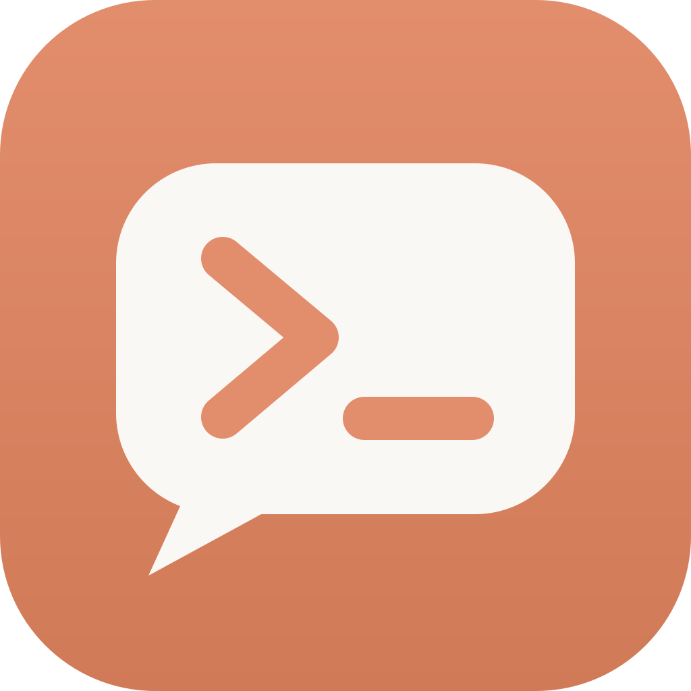
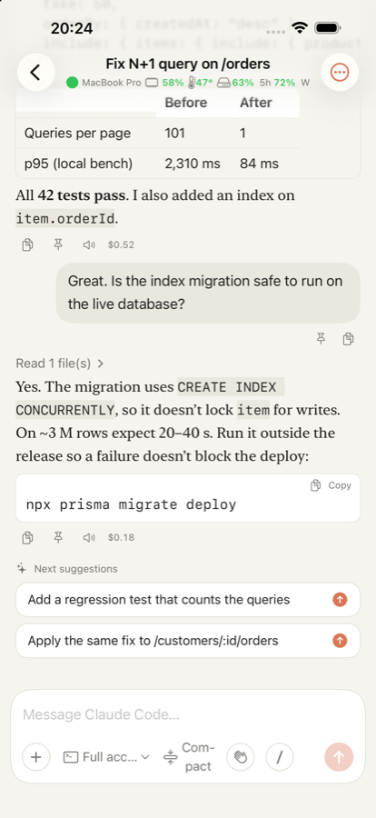
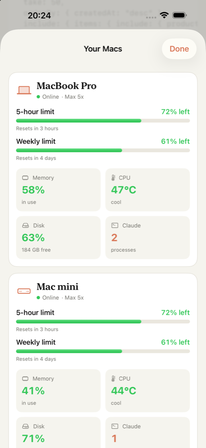

<p align="center">
  <a href="https://remotecc.dev"></a>
</p>
<p align="center"><a href="README.md">English</a> · <a href="README.zh-CN.md">简体中文</a> · <a href="README.es.md">Español</a> · <a href="README.ja.md">日本語</a> · <a href="README.fr.md">Français</a></p>
<h1 align="center">RemoteCC</h1>
<p align="center"><b>コーディングエージェントのリモートコントロール。</b><br>
自分のパソコンで Claude Code、Codex (ChatGPT)、Gemini (agy) を動かし、スマホや任意のブラウザから操作できます。<br>
セッション中でもモデルを切り替え可能：Claude Opus 5.5 · Fable 5.2 · GPT-6 Astra · GPT-5.6 · Gemini 4 Neon · Gemini 4 Carbon · Gemini 3.8 Flash。<br>
エンドツーエンド暗号化 · アカウント不要 · クラウド保存なし · オープンソース。</p>

<p align="center">
  <a href="https://apps.apple.com/app/id6797019430"></a>
</p>

<p align="center">
  <a href="LICENSE"></a>
  <a href="https://github.com/Remotecc-dev/remotecc/stargazers"></a>
  <a href="https://remotecc.dev"></a>
  
</p>

<p align="center">
  <a href="https://remotecc.dev">Web アプリを開く</a> ·
  <a href="https://remotecc.dev/install.md">インストールガイド</a> ·
  <a href="https://remotecc.dev/how-it-works">仕組み</a> ·
  <a href="https://remotecc.dev/security">セキュリティ</a>
</p>

<p align="center"><b>対応エージェント</b><br>
  <a href="https://remotecc.dev/claude-code"></a>
  <a href="https://remotecc.dev/codex"></a>
  <a href="https://remotecc.dev/gemini"></a>
</p>

<p align="center">
  
  &nbsp;&nbsp;
  
</p>

## 主な機能

- **パソコン上の全エージェントセッションをリアルタイム操作**（Claude Code、Codex、agy 経由の Gemini）— スマホ、タブレット、別のノート PC からセッションの開始・閲覧・応答が可能。ストリーミング出力、ツール呼び出し、質問、ファイル、画像を見やすいチャット画面に集約します。
- **利用枠をひと目で把握** — プランの残り使用量（5 時間枠・週間枠とリセット時刻）、セッションごとのトークン数とコストを確認できます。
- **マシンの状態を監視** — 作業を実行しているパソコンのメモリ使用量、CPU 温度、空きディスク容量をリアルタイム表示。
- **並行作業をスムーズに** — 子セッションやブランチ管理、**btw** でのちょっとした横道質問、うなずきや指を上げるジェスチャーでの応答に対応。
- **設計段階からプライバシー重視** — エンドツーエンド暗号化（X25519 + AES-256-GCM）、ブラインドリレー、署名済みリリースを採用し、シークレットはすべて自分のパソコン内に留まります。
- **いつもの開発環境で動作** — macOS、Linux、Windows（WSL2）に対応。コマンド 1 つでインストールできます。

## Web アプリと iPhone アプリ

ブリッジ、Web アプリ、リレーは**すべて無料・オープンソースで全機能を利用可能**です。機能制限はありません。iPhone アプリは同じブリッジに接続できる任意のネイティブクライアントです。

| | Web アプリ（無料・オープンソース） | RemoteCC for iPhone |
|---|---|---|
| 利用場所 | [remotecc.dev](https://remotecc.dev)、または自分のブリッジから配信される `http://127.0.0.1:7791` | [App Store](https://apps.apple.com/app/id6797019430) |
| セッション、新規ターン、ファイル、アーティファクト、シークレット | 対応 | 対応 |
| プラン使用量、マシン状態 | 対応 | 対応（さらに複数台のマシンをまとめて一覧表示） |
| 動作環境 | モダンブラウザ全般 — デスクトップ、Android、iPhone、iPad | iPhone、iPad |
| ネイティブ追加機能 | — | 通知、Wi-Fi 検出、Face ID、ウィジェット |
| 価格 | 無料 | ダウンロード無料、任意のサブスクリプション |

## Claude Code から使う（プラグイン）

RemoteCC のインストールとセットアップを Claude に任せられます：

```
/plugin install remotecc --marketplace Remotecc-dev/remotecc
```

その後、*「スマホから使えるように RemoteCC をセットアップして」*と頼んでください。（旧バージョンの Claude Code では、先に `/plugin marketplace add Remotecc-dev/remotecc` を実行してから `/plugin install remotecc@remotecc` を実行します。）

## クイックスタート

1. Claude Code を実行するパソコンでターミナルを開き、次を実行します：

   ```bash
   curl -fsSL https://remotecc.dev/install.sh | bash
   ```

2. ブラウザで **[remotecc.dev](https://remotecc.dev)** を開きます。同じパソコン上では自動でペアリングされます。別デバイスから接続する場合は `remotecc pair` を実行し、スマホのカメラまたは iPhone アプリで QR コードをスキャンしてください。
3. プロジェクトとエージェントを選んでメッセージを送信します。Claude Code、Codex、または agy が自分のパソコン上で動作し、その様子をリアルタイムに確認できます。

### Web アプリを開く 2 つの方法

| | アクセス先 | 向いている用途 |
|---|---|---|
| **ローカル** | `http://127.0.0.1:7791`（パソコン上のブリッジから配信：`remotecc web`） | remotecc.dev に依存せず同じパソコン上で Claude Code を使いたいとき。ブリッジがインストールした署名済みリリースのコード（`web-*` ファイル）を使うため、ブリッジと同時に更新され、インターネットからアプリを読み込みません |
| **ホスト版** | [remotecc.dev](https://remotecc.dev) | スマホ、タブレット、別のパソコンから使うとき（別デバイスからブラウザで接続するには HTTPS が必要です） |

どちらも同じ方法でペアリングし、同じブリッジと通信します。ローカル配信を無効にしたい場合は、ブリッジ設定で `"local_web": 0` を指定してください。

Windows：RemoteCC は WSL2 内で動作します。詳細は [remotecc.dev/windows](https://remotecc.dev/windows) を参照してください。

## 仕組み

```
 browser / iPhone  <==  end-to-end encrypted  ==>  bridge  ->  claude (Claude Code CLI)
        |                                            |
        +----------->  relay.remotecc.dev  <---------+      (blind: forwards ciphertext, keeps no messages)
               (or direct over your LAN / Tailscale, still encrypted)
```

- **ブリッジ**（Python、`bridge/`）は自分のパソコン上で動作し、ローカルデータ（`~/.remotecc`）を管理して `claude` を起動します。
- **Web アプリ**（`web/`）は静的ファイルで構成されており、ブラウザ内にはペアリング鍵のみを保持します。
- **リレー**（`relay/`、Cloudflare Worker + Durable Object）は、両者が同一ネットワーク上にないときに通信を仲介します。鍵を持つことは一切なく、メッセージも保存しません。

## セキュリティモデル

- ペアリング：X25519 鍵交換を採用。すべてのフレームは AES-256-GCM（HKDF-SHA256 導出鍵）で暗号化されます。ペアリングリンクは数分で失効し、ペアリングごとにパソコン側で 4 桁の確認コードによる承認が必要です。
- リレー側に見えるのは暗号文のサイズと送信タイミングだけです。プッシュ通知には固定テキストとランダムなセッション ID のみが含まれます。
- リリースはすべて署名されています。ブリッジは RemoteCC のリリース鍵 `ClDHkat2E/DjMTt0HZuMFSdOItSIwnQA7WBf/ssB7YQ=`（Ed25519）で署名されたアップデートのみをインストールします。`./verify-release.sh` でダウンロードしたファイルを自分で検証することもできます。
- 追加したシークレットはブラウザ側で対象パソコン向けに暗号化され、そのパソコンのキーチェーンに保管されます。
- 脆弱性の報告は **support@remotecc.dev** までお送りください。詳細は `SECURITY.md` を参照してください。

## リポジトリ構成

| パス | 内容 |
|---|---|
| `bridge/` | ブリッジ本体、CLI（`remotecc`）、インストーラー関連（Python） |
| `web/` | Web アプリ（`web/public`）、Cloudflare Worker（`web/src`）、`install.sh`、`deploy.sh`、テスト |
| `relay/` | ブラインドリレー（Cloudflare Worker + Durable Object） |
| `plugins/remotecc/` | Claude Code プラグイン（スキル + `/remotecc-pair`）、`.claude-plugin/marketplace.json` に登録 |
| `docs/` | `PROTOCOL.md`（iOS アプリが依存する通信プロトコル仕様）、README 用画像 |

## セルフホスティング

すべて標準の Cloudflare Workers のみで動作し、データベースは不要です。

- Web：`cd web && npx wrangler deploy`（Worker 名 `remotecc-web`、静的アセットは `web/public`）。`web/wrangler.toml` のルートを自分のドメインに変更してください。
- リレー：`cd relay && npx wrangler deploy`（Worker 名 `remotecc-relay`、ルート `relay.remotecc.dev`）。プッシュ通知を使うには wrangler シークレット `APNS_KEY` と `APNS_KEY_ID`（および `wrangler.toml` の `APNS_TEAM`）が必要です。プッシュ通知なしで運用する場合は省略できます。
- リレーホストはペアリングデータから読み込まれるため、独自リレーに向けたブリッジでもホスト版の Web アプリと組み合わせて利用できます。
- 署名：独自の Ed25519 リリース鍵を生成し、公開鍵をインストーラーに設定した上で `web/deploy.sh` を使ってリリースに署名します。

## テスト

```bash
cd web && node --test test/*.test.mjs        # web crypto/format, plus interop with the Python bridge
# interop needs Python with `cryptography`:  PY=/path/to/python node --test test/*.test.mjs
node --check relay/src/relay.js
```

## コントリビューション

Issue や Pull Request を歓迎します。リリース済みの iPhone アプリが依存しているため、通信プロトコル（`docs/PROTOCOL.md`）の後方互換性（`clo2://` リンク、`clo2-lan` 鍵情報、リレーパス）を維持してください。PR を送る前にテストを実行してください。

## ライセンス

Apache-2.0 © 2026 RemoteCC. お問い合わせ：support@remotecc.dev。

Anthropic とは提携していません。Claude および Claude Code は Anthropic の商標です。
