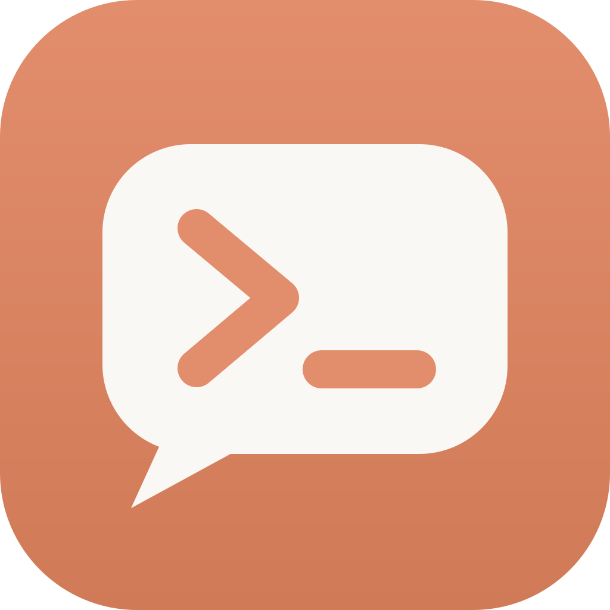
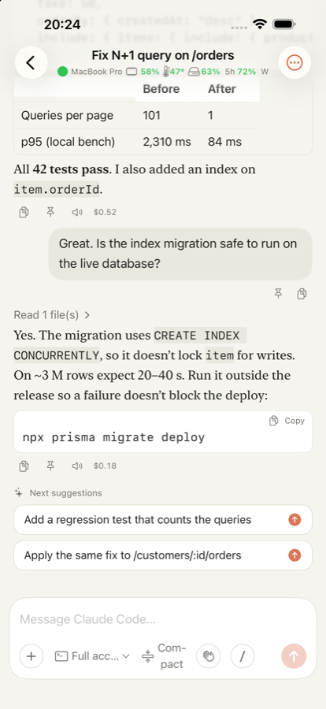
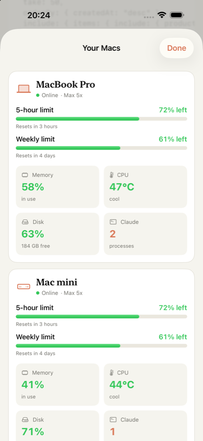

<p align="center">
  <a href="https://remotecc.dev"></a>
</p>
<h1 align="center">RemoteCC</h1>
<p align="center"><b>The remote control for your coding agents.</b><br>
Run Claude Code and Codex on your own computer — drive them from your phone or any browser.<br>
End-to-end encrypted · no account · nothing stored in the cloud · open source.</p>

<p align="center">
  <a href="https://apps.apple.com/app/id6797019430"></a>
</p>

<p align="center">
  <a href="LICENSE"></a>
  <a href="https://github.com/Remotecc-dev/remotecc/stargazers"></a>
  <a href="https://remotecc.dev"></a>
  
</p>

<p align="center">
  <a href="https://remotecc.dev">Open the web app</a> ·
  <a href="https://remotecc.dev/install.md">Install guide</a> ·
  <a href="https://remotecc.dev/how-it-works">How it works</a> ·
  <a href="https://remotecc.dev/security">Security</a>
</p>

<p align="center"><b>Works with</b><br>
  <a href="https://remotecc.dev/claude-code"></a>
  <a href="https://remotecc.dev/codex"></a>
  
</p>

<p align="center">
  
  &nbsp;&nbsp;
  
</p>

## What you get

- **Every agent session on your computer, live** — start, watch and answer from your phone, tablet or another laptop:
  streaming output, tool calls, questions, files and images in one clean chat view.
- **Know your limits** — plan usage left (5-hour and weekly windows, reset times), tokens and cost per session.
- **Watch your machine** — RAM in use, CPU temperature and free disk space of the computer doing the work.
- **Work in parallel** — child sessions and branches, quick side questions with **btw**, answers by nod or raised fingers.
- **Private by design** — end-to-end encrypted (X25519 + AES-256-GCM), blind relay, signed releases, secrets stay on
  your computer.
- **Runs where you code** — macOS, Linux and Windows (WSL2). One command to install.

## Web or iPhone app

The bridge, the web app and the relay are **free and open source, with every feature** — nothing is gated. The iPhone
app is an optional native client for the same bridge.

| | Web app (free, open source) | RemoteCC for iPhone |
|---|---|---|
| Where | [remotecc.dev](https://remotecc.dev), or served by your own bridge at `http://127.0.0.1:7791` | [App Store](https://apps.apple.com/app/id6797019430) |
| Sessions, new turns, files, artifacts, secrets | Yes | Yes |
| Plan usage, machine health | Yes | Yes, plus a multi-computer overview |
| Works on | Any modern browser — desktop, Android, iPhone, iPad | iPhone, iPad |
| Native extras | — | Notifications, Wi-Fi discovery, Face ID, widgets |
| Price | Free | Free download, optional subscription |

## Use it from Claude Code (plugin)

Let Claude install and set up RemoteCC for you:

```
/plugin install remotecc --marketplace Remotecc-dev/remotecc
```

Then ask: *"Set up RemoteCC so I can use this from my phone."* (Older Claude Code: `/plugin marketplace add
Remotecc-dev/remotecc`, then `/plugin install remotecc@remotecc`.)

## Quick start

1. On the computer that runs Claude Code, open a terminal and run:

   ```bash
   curl -fsSL https://remotecc.dev/install.sh | bash
   ```

2. Open **[remotecc.dev](https://remotecc.dev)** in a browser. On the same computer it pairs by itself; from another
   device run `remotecc pair` and scan the QR code with the
   phone camera or the iPhone app.
3. Pick a project, send a message. Claude Code (or Codex) runs on your computer; you see it live.

### Two ways to open the web app

| | Where | Good for |
|---|---|---|
| **Local** | `http://127.0.0.1:7791`, served by the bridge on your computer (`remotecc web`) | Using Claude Code on the same computer without depending on remotecc.dev. Same code as the site, taken from the signed release the bridge installed (`web-*` files), so it updates with the bridge and never loads the app from the internet |
| **Hosted** | [remotecc.dev](https://remotecc.dev) | Phones, tablets and other computers (browsers need HTTPS to reach your computer from another device) |

Both pair the same way and talk to the same bridge. Turn the local one off with `"local_web": 0` in the bridge config.

Windows: RemoteCC runs inside WSL2 — see [remotecc.dev/windows](https://remotecc.dev/windows).

## How it works

```
 browser / iPhone  <==  end-to-end encrypted  ==>  bridge  ->  claude (Claude Code CLI)
        |                                            |
        +----------->  relay.remotecc.dev  <---------+      (blind: forwards ciphertext, keeps no messages)
               (or direct over your LAN / Tailscale, still encrypted)
```

- The **bridge** (Python, `bridge/`) runs on your computer, owns the data (`~/.remotecc`) and launches `claude`.
- The **web app** (`web/`) is static files; it holds only a pairing key in your browser.
- The **relay** (`relay/`, a Cloudflare Worker + Durable Object) connects the two when they are not on the same network.
  It never has a key and stores no messages.

## Security model

- Pairing: X25519 key agreement; every frame is AES-256-GCM (HKDF-SHA256 derived keys); the pairing link expires in
  minutes and each pairing is confirmed with a 4-digit code on the computer.
- The relay only sees ciphertext sizes and timing. Push notifications carry fixed text and a random session id.
- Releases are signed. The bridge only installs updates signed with the RemoteCC release key
  `ClDHkat2E/DjMTt0HZuMFSdOItSIwnQA7WBf/ssB7YQ=` (Ed25519). Verify a download yourself with `./verify-release.sh`.
- Secrets you add are encrypted in the browser for your computer and kept in its keychain.
- Report vulnerabilities to **support@remotecc.dev**; see `SECURITY.md`.

## Repository layout

| Path | What |
|---|---|
| `bridge/` | The bridge, CLI (`remotecc`) and installer pieces (Python) |
| `web/` | The web app (`web/public`), its Cloudflare Worker (`web/src`), `install.sh`, `deploy.sh`, tests |
| `relay/` | The blind relay (Cloudflare Worker + Durable Object) |
| `plugins/remotecc/` | Claude Code plugin (skill + `/remotecc-pair`), listed by `.claude-plugin/marketplace.json` |
| `docs/` | `PROTOCOL.md` (wire format the iOS app relies on), README images |

## Self-hosting

Everything is plain Cloudflare Workers; no database.

- Web: `cd web && npx wrangler deploy` (worker `remotecc-web`, static assets from `web/public`). Change the route in
  `web/wrangler.toml` to your domain.
- Relay: `cd relay && npx wrangler deploy` (worker `remotecc-relay`, route `relay.remotecc.dev`). Push notifications need
  the wrangler secrets `APNS_KEY` and `APNS_KEY_ID` (and `APNS_TEAM` in `wrangler.toml`); skip them to run without push.
- The relay host is taken from the pairing data, so a bridge pointed at your own relay works with the hosted web app too.
- Signing: generate your own Ed25519 release key, publish its public key in the installer, and sign releases with `web/deploy.sh`.

## Tests

```bash
cd web && node --test test/*.test.mjs        # web crypto/format, plus interop with the Python bridge
# interop needs Python with `cryptography`:  PY=/path/to/python node --test test/*.test.mjs
node --check relay/src/relay.js
```

## Contributing

Issues and pull requests are welcome. Keep the wire protocol (`docs/PROTOCOL.md`) backward compatible: the shipped iPhone
app depends on it (`clo2://` links, `clo2-lan` key info, relay paths). Run the tests before sending a PR.

## Licence

Apache-2.0 © 2026 RemoteCC. Contact: support@remotecc.dev.

Not affiliated with Anthropic. Claude and Claude Code are trademarks of Anthropic.
