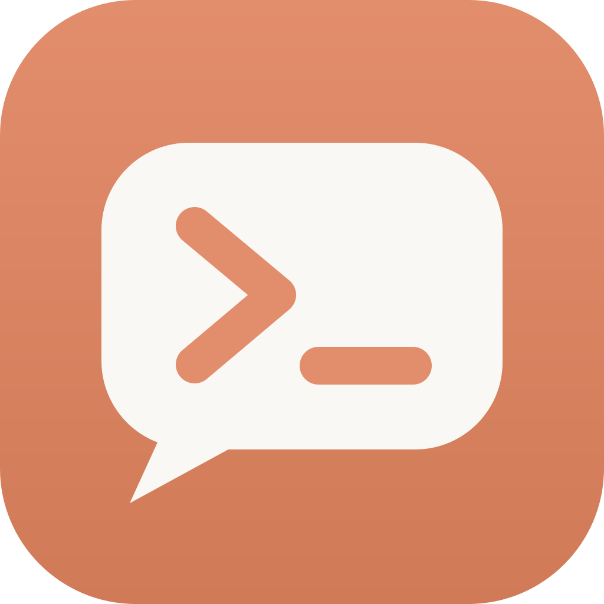
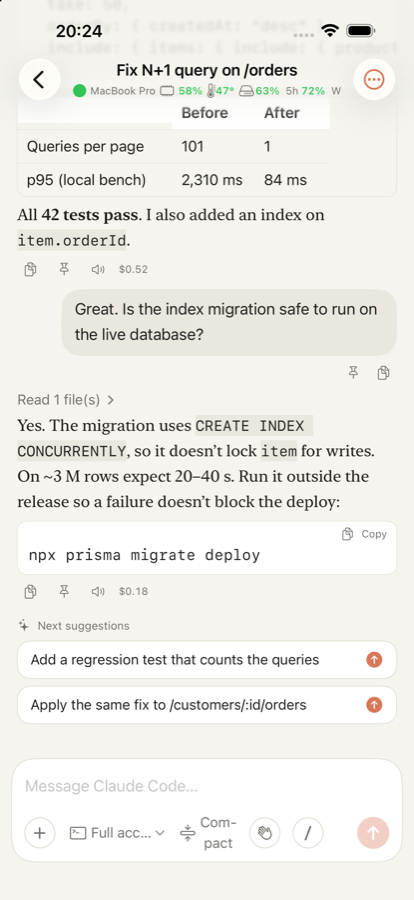
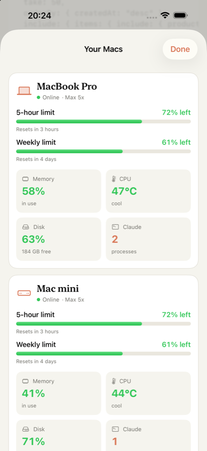

<p align="center">
  <a href="https://remotecc.dev"></a>
</p>
<p align="center"><a href="README.md">English</a> · <a href="README.zh-CN.md">简体中文</a> · <a href="README.es.md">Español</a> · <a href="README.ja.md">日本語</a> · <a href="README.fr.md">Français</a></p>
<h1 align="center">RemoteCC</h1>
<p align="center"><b>编程 Agent 的远程控制台。</b><br>
在自己的电脑上运行 Claude Code 和 Codex，随时用手机或任意浏览器远程操控。<br>
端到端加密 · 无需账号 · 云端零存储 · 开源。</p>

<p align="center">
  <a href="https://apps.apple.com/app/id6797019430"></a>
</p>

<p align="center">
  <a href="LICENSE"></a>
  <a href="https://github.com/Remotecc-dev/remotecc/stargazers"></a>
  <a href="https://remotecc.dev"></a>
  
</p>

<p align="center">
  <a href="https://remotecc.dev">打开网页应用</a> ·
  <a href="https://remotecc.dev/install.md">安装指南</a> ·
  <a href="https://remotecc.dev/how-it-works">工作原理</a> ·
  <a href="https://remotecc.dev/security">安全说明</a>
</p>

<p align="center"><b>支持的工具</b><br>
  <a href="https://remotecc.dev/claude-code"></a>
  <a href="https://remotecc.dev/codex"></a>
  
</p>

<p align="center">
  
  &nbsp;&nbsp;
  
</p>

## 核心功能

- **实时掌控电脑上的所有 Agent 会话** —— 用手机、平板或另一台电脑发起、查看并回复会话：流式输出、工具调用、交互提问、文件和图片都汇聚在清爽统一的聊天界面中。
- **用量额度一目了然** —— 实时查看套餐剩余额度（5 小时及每周周期与重置时间），以及每个会话的 token 消耗和费用。
- **监控主机状态** —— 随时查看运行任务的电脑内存占用、CPU 温度和剩余磁盘空间。
- **高效并行协作** —— 支持子会话和分支，可用 **btw** 随时发起旁路提问，还支持通过点头或比出手指快速回复。
- **默认隐私优先** —— 端到端加密（X25519 + AES-256-GCM）、盲中继转发、发布包签名校验，所有密钥与敏感信息都留在本地电脑上。
- **贴合你的开发环境** —— 支持 macOS、Linux 和 Windows（WSL2），一条命令即可完成安装。

## 网页端还是 iPhone 客户端

桥接程序（bridge）、网页应用和中继服务**全部免费开源，完整提供所有功能**，没有任何付费墙限制。iPhone 应用则是同一套桥接服务的可选原生客户端。

| | 网页应用（免费、开源） | RemoteCC for iPhone |
|---|---|---|
| 获取方式 | [remotecc.dev](https://remotecc.dev)，或由本地桥接服务提供：`http://127.0.0.1:7791` | [App Store](https://apps.apple.com/app/id6797019430) |
| 会话、新对话、文件、产物、密钥管理 | 支持 | 支持 |
| 套餐用量、主机健康状态 | 支持 | 支持，并提供多机总览视图 |
| 支持设备 | 任意现代浏览器 —— 桌面端、Android、iPhone、iPad | iPhone、iPad |
| 原生增强功能 | — | 推送通知、Wi-Fi 局域网发现、Face ID、桌面小组件 |
| 价格 | 免费 | 免费下载，可选订阅 |

## 在 Claude Code 中使用（插件）

直接让 Claude 帮你安装和配置 RemoteCC：

```
/plugin install remotecc --marketplace Remotecc-dev/remotecc
```

接着对它说：*“帮我配置 RemoteCC，让我可以在手机上使用。”*（旧版 Claude Code 请先运行 `/plugin marketplace add Remotecc-dev/remotecc`，再运行 `/plugin install remotecc@remotecc`。）

## 快速开始

1. 在运行 Claude Code 的电脑上打开终端，执行：

   ```bash
   curl -fsSL https://remotecc.dev/install.sh | bash
   ```

2. 在浏览器中打开 **[remotecc.dev](https://remotecc.dev)**。在同一台电脑上会自动完成配对；如需从其他设备连接，请运行 `remotecc pair`，并用手机相机或 iPhone 客户端扫描二维码。
3. 选择项目并发送消息。Claude Code（或 Codex）会在你的电脑上运行，你可以实时查看完整过程。

### 打开网页应用的两种方式

| | 访问地址 | 适用场景 |
|---|---|---|
| **本地** | `http://127.0.0.1:7791`，由本机桥接程序提供（`remotecc web`） | 在同一台电脑上使用 Claude Code，不依赖 remotecc.dev。代码与线上站点完全一致，直接来自桥接程序安装的签名发布包（`web-*` 文件），随桥接程序同步更新，无需从互联网加载前端应用 |
| **托管** | [remotecc.dev](https://remotecc.dev) | 手机、平板和其他电脑（浏览器跨设备访问本机需要 HTTPS） |

两种方式的配对流程相同，连接的也是同一个桥接服务。如需关闭本地网页入口，可在桥接配置中设置 `"local_web": 0`。

Windows 用户：RemoteCC 运行在 WSL2 中，详见 [remotecc.dev/windows](https://remotecc.dev/windows)。

## 工作原理

```
 browser / iPhone  <==  end-to-end encrypted  ==>  bridge  ->  claude (Claude Code CLI)
        |                                            |
        +----------->  relay.remotecc.dev  <---------+      (blind: forwards ciphertext, keeps no messages)
               (or direct over your LAN / Tailscale, still encrypted)
```

- **桥接程序（bridge）**（Python，`bridge/`）运行在你的电脑上，负责管理本地数据（`~/.remotecc`）并启动 `claude`。
- **网页应用**（`web/`）是纯静态文件，只在浏览器本地保存配对密钥。
- **中继服务（relay）**（`relay/`，基于 Cloudflare Worker + Durable Object）在两端不在同一网络时负责桥接通信。它从不持有密钥，也不存储任何消息内容。

## 安全模型

- 配对采用 X25519 密钥协商；每一帧数据均使用 AES-256-GCM 加密（密钥由 HKDF-SHA256 派生）；配对链接数分钟后自动失效，且每次配对都需在电脑端核对 4 位验证码确认。
- 中继服务器只能看到密文大小与收发时间。推送通知仅包含固定文案和一个随机会话 ID。
- 所有发布版本均经过数字签名。桥接程序只会安装由 RemoteCC 发布密钥 `ClDHkat2E/DjMTt0HZuMFSdOItSIwnQA7WBf/ssB7YQ=`（Ed25519）签名的更新。你也可以运行 `./verify-release.sh` 自行校验下载文件。
- 你添加的密钥信息会在浏览器中针对目标电脑加密，并保存在电脑的系统钥匙串中。
- 如发现安全漏洞，请发送邮件至 **support@remotecc.dev**，详情参见 `SECURITY.md`。

## 仓库结构

| 路径 | 说明 |
|---|---|
| `bridge/` | 桥接程序、CLI 工具（`remotecc`）以及安装组件（Python） |
| `web/` | 网页应用（`web/public`）、对应的 Cloudflare Worker（`web/src`）、`install.sh`、`deploy.sh` 与测试 |
| `relay/` | 盲中继服务（Cloudflare Worker + Durable Object） |
| `plugins/remotecc/` | Claude Code 插件（skill + `/remotecc-pair`），在 `.claude-plugin/marketplace.json` 中注册 |
| `docs/` | `PROTOCOL.md`（iOS 应用依赖的通信协议格式）及 README 图片 |

## 自托管部署

整个后端仅依赖标准的 Cloudflare Workers，无需任何数据库。

- 网页端：`cd web && npx wrangler deploy`（Worker 名称 `remotecc-web`，静态资源位于 `web/public`）。将 `web/wrangler.toml` 中的路由改为你自己的域名即可。
- 中继端：`cd relay && npx wrangler deploy`（Worker 名称 `remotecc-relay`，路由 `relay.remotecc.dev`）。如需启用推送通知，需配置 wrangler secrets `APNS_KEY` 和 `APNS_KEY_ID`（并在 `wrangler.toml` 中设置 `APNS_TEAM`）；不需要推送则可直接跳过。
- 中继主机地址来自配对数据，因此指向自建中继的桥接程序同样可以直接配合官方托管的网页应用使用。
- 签名发布：生成你自己的 Ed25519 发布密钥，将公钥写入安装脚本，然后使用 `web/deploy.sh` 为发布包签名。

## 测试

```bash
cd web && node --test test/*.test.mjs        # web crypto/format, plus interop with the Python bridge
# interop needs Python with `cryptography`:  PY=/path/to/python node --test test/*.test.mjs
node --check relay/src/relay.js
```

## 参与贡献

欢迎提交 Issue 和 Pull Request。请保持通信协议（`docs/PROTOCOL.md`）向后兼容，因为已发布的 iPhone 应用依赖这些约定（`clo2://` 链接、`clo2-lan` 密钥信息、中继路径）。提交 PR 前请先运行测试。

## 许可证

Apache-2.0 © 2026 RemoteCC。联系邮箱：support@remotecc.dev。

本项目与 Anthropic 无隶属关系。Claude 和 Claude Code 均为 Anthropic 的商标。
